# What actually predicts next week's fantasy points?

Every week, fantasy football managers choose between players using recent form, matchups, and Vegas lines.
This project tests those instincts against **27 NFL seasons (1999-2025, 144,000 player-games)**: how the game
changed, what never did, and a projection model scored on a season it never saw.

**Python · pandas · scikit-learn · matplotlib · Jupyter** · data from [nflverse](https://github.com/nflverse/nflverse-data)

## Findings: the modern game (2021-2025)

### 1. Volume is a trait. Touchdowns and efficiency are mostly noise.

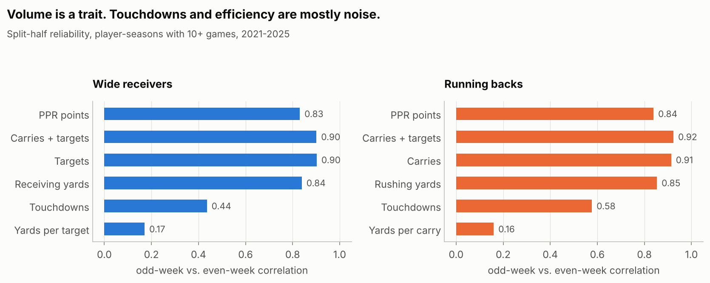

Averaging a stat over odd weeks and over even weeks, then correlating the two halves, separates role from luck.
Targets and carries repeat almost perfectly (r ≈ 0.9). Touchdowns repeat far less (r ≈ 0.4-0.6), and yards per
target or per carry hardly repeat at all. When a player's points outrun their volume, expect a pullback.

### 2. The full season beats the hot hand

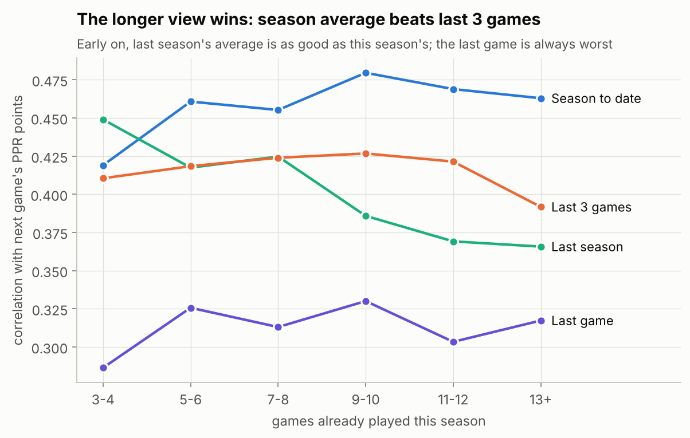

The last game is the weakest predictor at every point in the season, and the last three games trail the
season-to-date average. Early in the year, **last season's** average is as informative as this season's.

### 3. Matchups and Vegas totals matter, but far less than people assume

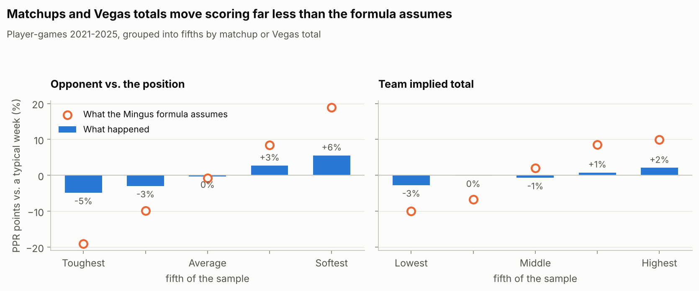

From the toughest fifth of matchups to the softest, scoring moves about **10%** relative to a typical week. The
Start/Sit heuristic on my fantasy site ([Mingus Sports](https://joshwilliams332.github.io/mingus/)) assumes about
**38%** across the same groups. Vegas implied totals add about 5% once a player's average is known.

### 4. A simple model beats every rule of thumb on unseen games

Trained on 2021-2023, tuned on 2024, tested once on 2025 (2,591 player-games):

| Projection | MAE (pts) | Correlation | Start/sit accuracy |
|---|---:|---:|---:|
| Last game | 7.53 | 0.290 | 58.7% |
| Last 3 games | 6.24 | 0.400 | 62.6% |
| Season average | 5.87 | 0.450 | 64.1% |
| Mingus site formula | 6.08 | 0.432 | 64.0% |
| Gradient boosting | **5.63** | 0.475 | 64.9% |
| **Ridge regression** | 5.67 | **0.488** | **65.5%** |

*Start/sit accuracy: across every pair of same-position players in the same week, how often the one projected
higher actually scored more (50% = coin flip).*

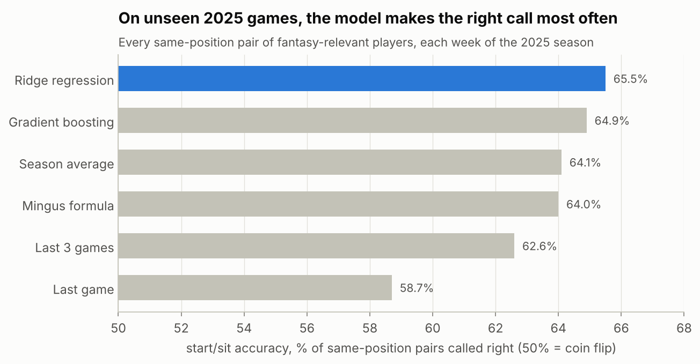

A linear model was enough. Gradient boosting didn't find interactions worth its extra complexity.

### 5. Know when it's a coin flip

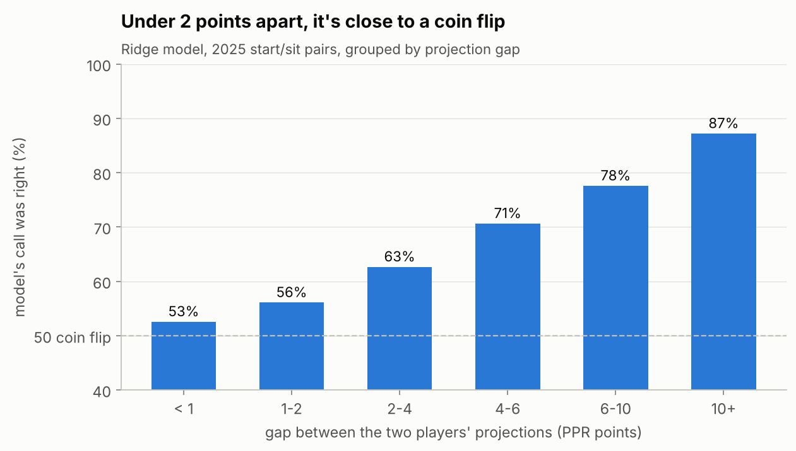

When two players' projections are under 2 points apart, no projection is much better than a coin. At 6+ points,
the call is right about 4 times in 5.

### What the model weighs

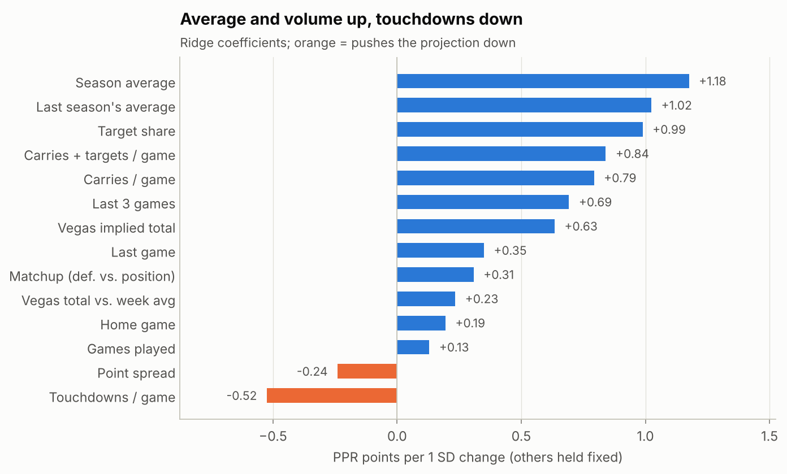

Target share, this season's average, and last season's average carry the most weight. Touchdowns per game is
*negative* once points and volume are known: the model has learned to expect touchdown streaks to fade.

## Findings: 27 seasons of history (1999-2025)

### 6. The game changed...

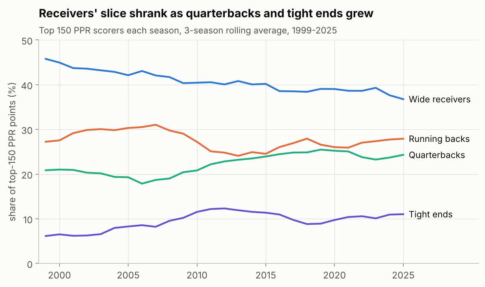

Wide receivers' share of top-150 fantasy points fell from about 46% to about 37% (3-season average). Quarterbacks and
tight ends took most of it.

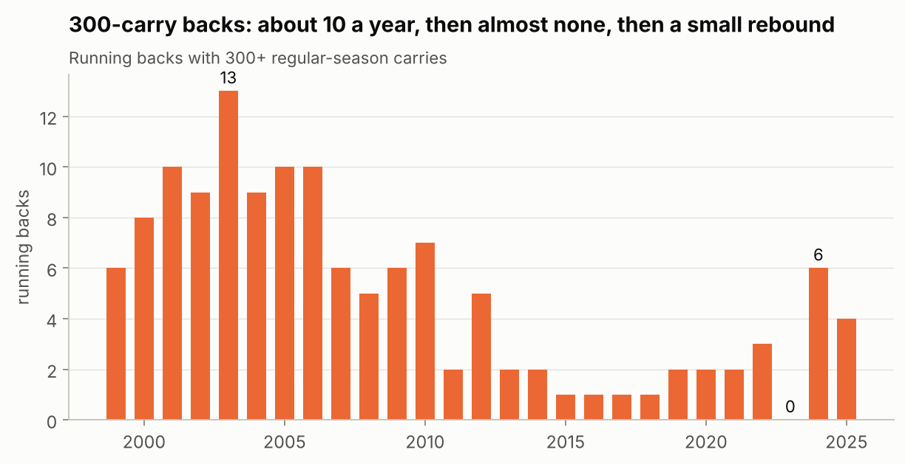

The 300-carry back went from about 10 a season in the early 2000s to none in 2023, with a small rebound since.

### 7. ...but what predicts fantasy points didn't

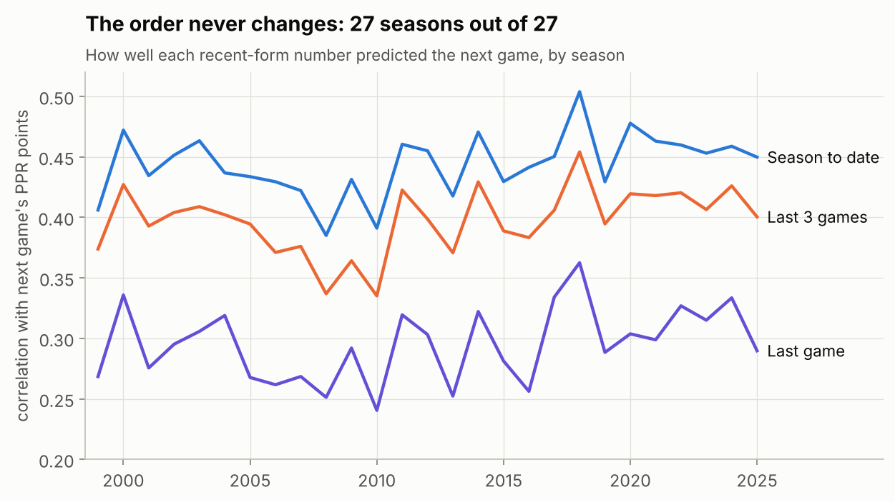

Season average beat the last 3 games, and the last 3 beat the last game, in **all 27 seasons**. Finding 2 is not a
quirk of the modern NFL.

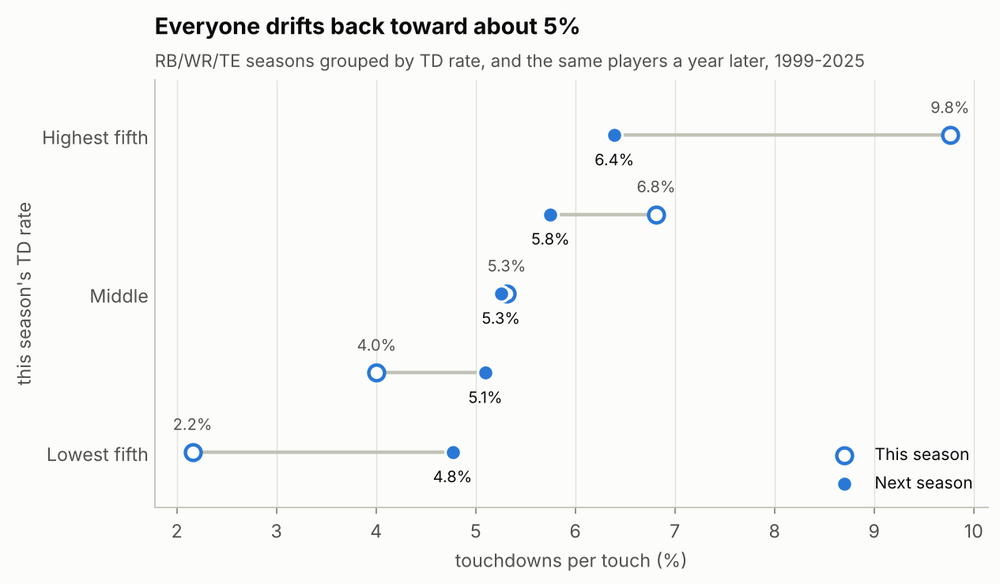

Touchdown spikes fade over full seasons too. The top fifth by touchdowns per touch dropped from 9.8% to 6.4% the next
year, while their touches per game held steady. Year-to-year correlation: 0.54 for TD rate, 0.85 for touches per game.

### 8. Aging curves

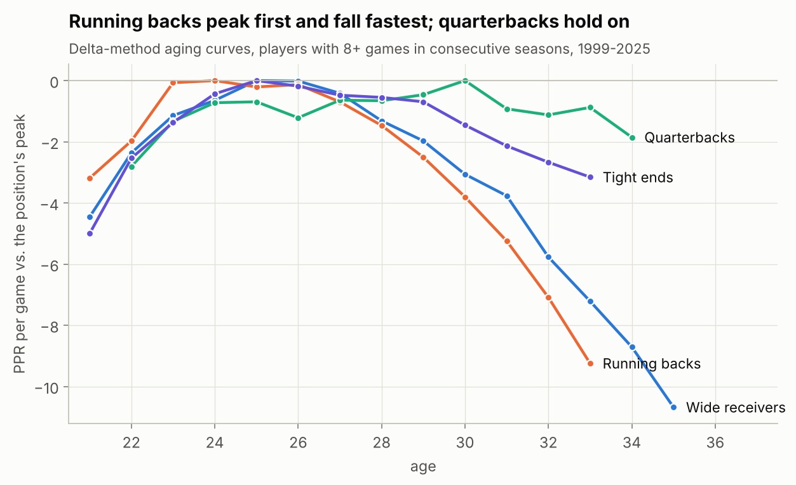

Delta method (each player compared only with themselves, year over year). Running backs peak at about 24 and fall
off steeply after 26. Receivers and tight ends peak around 25-26 and decline more gradually. Quarterbacks peak around
30 and hold up into their mid-30s. Survivors only, so real declines are steeper.

### 9. More history doesn't make a better weekly model

| Ridge trained on | Rows | 2025 MAE | Start/sit accuracy |
|---|---:|---:|---:|
| 2021-2023 | 7,894 | 5.674 | 65.5% |
| 2015-2023 | 23,280 | 5.668 | 65.5% |
| 2009-2023 | 38,186 | 5.670 | 65.5% |

Five times the data, the same accuracy. The ceiling is the noise in a single game, not a shortage of examples.
Better *information* (injuries, snap counts, depth charts) is what would move it.

## Method

* **No look-ahead.** Every feature for week *t* uses only games before *t*: rolling stats are shifted one game,
  and a defense's points-allowed figure only counts earlier weeks. Unit tests in `tests/` check this on toy data.
* **Time-based split**, not random: a random split would let the model learn from games after the ones it predicts.
* **Sample:** QB/RB/WR/TE player-games where the player had 3+ earlier games that season averaging 5+ PPR,
  which roughly covers anyone a manager would consider starting.
* **Data cleaning:** player stats use today's franchise codes for every season (LV, LAC, LA) while schedules use the
  city at the time (OAK, SD, STL), so schedules are mapped to franchises. nflverse has almost no targets for 2003-2008;
  those are set to missing rather than zero, and model training never starts before 2009.
* **Matchup feature:** PPR points a defense allowed per game to the position, ÷ the league average over the same
  weeks. **Vegas feature:** implied team total = (over/under ± spread) / 2.

## Limitations

* Only players who played appear in the data, so injuries and surprise inactives (a big part of real start/sit
  risk) aren't modeled.
* No snap counts, routes, depth charts, or injury news, all of which a real projection would use.
* Defense-vs-position numbers depend on which players a defense happened to face; an opponent-adjusted version
  would likely make the matchup effect a bit stronger.
* Scoring is full PPR; results for half-PPR and standard should be similar but weren't tested.

## Run it

```bash
python -m venv .venv && source .venv/bin/activate
pip install -r requirements.txt
pytest                      # feature leakage tests
jupyter lab notebooks/      # run 01 -> 04 in order; ~210 MB of nflverse data downloads to data/raw on first run
```

## Layout

```
notebooks/
  01_data_and_features.ipynb     load nflverse data, scoring check, features, leakage spot check
  02_what_is_predictable.ipynb   reliability, recent-form windows, matchup and Vegas effects
  03_projection_model.ipynb      baselines vs. ridge vs. gradient boosting, start/sit evaluation
  04_history.ipynb               1999-2025: position shares, workhorse RBs, era checks, TD regression, aging, training window
src/fantasy/
  data.py        download + cache nflverse player weeks, schedules (with Vegas lines), birth dates
  features.py    leakage-safe features, model sample, the Mingus heuristic
  evaluate.py    MAE / start/sit accuracy scoring
  plots.py       shared chart style (colorblind-checked palette)
tests/           unit tests for the no-look-ahead guarantees
reports/figures/ charts used above
```
